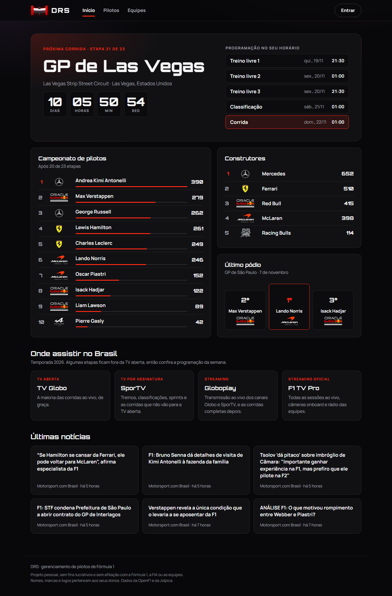

# DRS

**Data Retrieval System**: busca os dados da Fórmula 1 (pilotos, equipes, corridas e a história desde 1950) e apresenta tudo num painel com interface inspirada na identidade visual das corridas.

**Acesse:** https://drs-umcj.onrender.com



A sigla é um trocadilho com o DRS da F1, o Drag Reduction System, a asa traseira móvel que abre na reta. Por isso o logo é uma asa, e o flap abre sempre que a aplicação busca dados.

## Funcionalidades

- **Página inicial:** próxima corrida com contagem regressiva e programação no fuso de quem visita, campeonato de pilotos e de construtores, último pódio, onde assistir no Brasil e últimas notícias
- **Calendário da temporada:** todas as etapas com data, circuito e vencedor, e a classificação completa de cada GP com largada, posições ganhas, tempo, abandonos e volta mais rápida
- **História da F1:** os campeões de pilotos e de construtores de cada ano desde 1950, o ranking dos maiores campeões e a página de qualquer temporada encerrada, com classificação, equipes e o vencedor de cada corrida. A API guarda os campeões no banco na primeira vez e não consulta de novo
- **Comparar pilotos:** dois pilotos lado a lado, com quem terminou à frente nas corridas e no grid, os números da temporada e um gráfico dos pontos acumulados etapa a etapa
- **Grid de pilotos:** busca ao vivo por piloto ou equipe, filtro por equipe e paginação
- **Grid sempre atualizado:** a API reimporta a temporada sozinha quando a última importação passa de 24 horas, e o administrador ainda pode importar na hora com um clique. Os campeões das temporadas passadas ficam guardados no banco, então só os anos que faltam são consultados
- **Cadastro e edição** de pilotos e equipes, com prévia em tempo real e acesso restrito ao administrador
- Logo e cores de cada equipe, e bandeira do país de cada piloto
- Validação compartilhada entre API e interface, com mensagens em português

## Tecnologias

- **API:** Node.js, TypeScript, Fastify, Drizzle ORM, PostgreSQL
- **Interface:** React, Vite, React Router, TanStack Query, React Hook Form
- **Compartilhado:** schemas Zod usados pelos dois lados
- **Qualidade:** Vitest, ESLint, Prettier, GitHub Actions
- **Hospedagem:** Render (API e site) e Neon (PostgreSQL)

## Arquitetura

Monorepo com pnpm workspaces:

```
apps/
  api/                Fastify
    src/domain/       entidades e erros de negócio, sem dependência de framework
    src/application/  casos de uso e portas (repositórios e fontes de dados externas)
    src/infra/        PostgreSQL com Drizzle, clientes das APIs da F1, RSS e rotas HTTP
  web/                React
    src/features/     telas organizadas por funcionalidade
    src/shared/       componentes, cliente HTTP e utilitários
packages/
  contracts/          schemas Zod compartilhados entre API e interface
```

A regra de dependência entre as camadas da API é verificada pelo ESLint: o domínio não importa a aplicação nem a infraestrutura, e a aplicação não importa a infraestrutura.

Os dados externos (OpenF1, Jolpica e o RSS de notícias) entram pela infraestrutura, são validados com Zod antes de chegar aos casos de uso e ficam em cache por alguns minutos. Se uma fonte falhar, a API mantém o último dado bom.

## Como rodar

Pré-requisitos: Node.js 24, pnpm (via `corepack enable`) e Docker.

```bash
git clone https://github.com/mtepeaceful/DRS.git
cd DRS
pnpm install
cp .env.example .env
cp apps/api/.env.example apps/api/.env
pnpm --filter @drs/api gerar-credenciais
pnpm db:up
pnpm --filter @drs/api db:migrate
pnpm dev
```

O comando `gerar-credenciais` pede a senha do administrador sem exibi-la e grava `ADMIN_SENHA_HASH` e `SEGREDO_DA_SESSAO` em `apps/api/.env`. Em terminais que não aceitam digitação oculta, use `--arquivo <caminho>`: a senha é lida de um arquivo, que é apagado em seguida.

Use a mesma senha em `.env` e em `apps/api/.env`. A interface fica em `http://localhost:5173` e a API em `http://localhost:3333`.

### Modo demonstração

Para rodar sem Docker, defina `ARMAZENAMENTO=memoria` em `apps/api/.env`. A API passa a guardar os dados em memória, e eles somem ao reiniciar.

A escolha do armazenamento é feita por uma fábrica (`apps/api/src/infra/criar-repositorios.ts`): o resto da aplicação recebe os repositórios pelas interfaces e não sabe qual implementação está em uso.

## Segurança

- Leitura pública; cadastrar, editar e excluir exigem a sessão de administrador
- Senha guardada apenas como hash scrypt, comparada em tempo constante, com no mínimo 12 caracteres
- Sessão assinada com HMAC-SHA256, válida por 8 horas
- Login limitado a 5 tentativas por minuto por IP e limite geral de 300 requisições por minuto
- Corpo das requisições limitado a 16 KB e validado pelos schemas compartilhados
- CORS restrito ao domínio do site, headers de segurança na API (Helmet) e Content Security Policy no site
- Consultas parametrizadas pelo Drizzle, com escape dos curingas da busca

## Testes

```bash
pnpm test
pnpm test:integracao
pnpm test:e2e
```

- `pnpm test`: testes de unidade e de rotas da API e testes das telas do front com Testing Library, com a API simulada pelo MSW
- `pnpm test:integracao`: repositórios contra o banco `drs_test`, criado automaticamente pelo Docker Compose
- `pnpm test:e2e`: Playwright no Chrome, no desktop e no celular. Sobe a API em modo memória e o site já compilado, entra como administrador e cadastra, edita, busca e exclui um piloto de verdade

## Versão 1

A primeira versão, em Laravel, está preservada na tag [`v1.0.0`](https://github.com/mtepeaceful/DRS/tree/v1.0.0).

## Aviso

Projeto pessoal, sem fins lucrativos e sem afiliação com a Fórmula 1, a FIA ou as equipes. Nomes, marcas e logos pertencem aos seus respectivos donos e são usados apenas para identificação. Dados da temporada fornecidos pela [OpenF1](https://openf1.org) e pela [Jolpica](https://github.com/jolpica/jolpica-f1).
